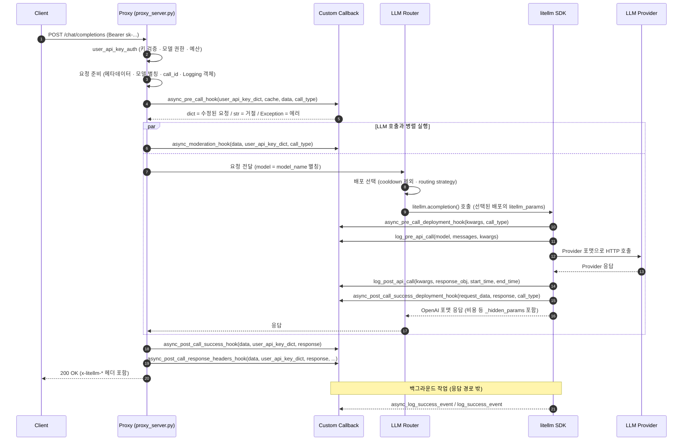
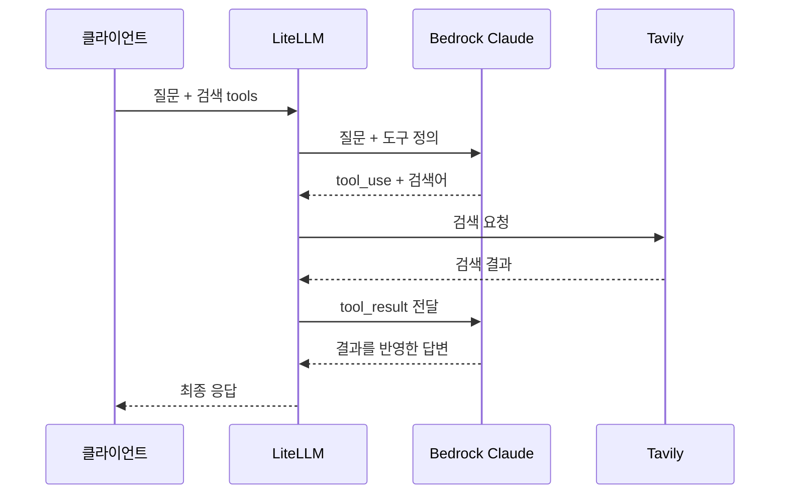

# LiteLLM 스터디

## 1. LiteLLM 이란?

**LiteLLM**은 전 세계의 다양한 대형 언어 모델(LLM, Large Language Model)을 **OpenAI API 표준 규격**으로 통일하여 쉽게 호출하고 관리할 수 있도록 도와주는 오픈소스 LLM Proxy이며`chat/completions` (OpenAI API) 외 `/v1/messages` (ClaudSDK) 등 다양한 엔드포인트들도 지원하고 있습니다.

가장 큰 특징은 많은 사용자들의 LLM 요청을 중앙 집중 관리하며 통제 및 제어할 수 있도록 관문(proxy/gateway) 역할을 합니다. 사용자들의 토큰 사용량 관찰 및 제어, 권한 설정, 자체 가드레일 적용 및 로깅 등 다양한 기능들도 같이 지원하고 있습니다.

금융권에서는 망 분리 규제 개선에 따라 관련 제도와 보안 요건을 충족하는 범위에서 외부 클라우드 및 생성형 AI 서비스의 활용이 확대되면서 LLM Gateway와 Amazon Bedrock 연동으로 개발 생산성 향상과 민감정보 필터링·접근 제어·감사 로그 등의 보안 통제를 구성하여 정보 유출 위험을 낮출 수 있습니다.

.*](image.png)

*그림 1. 입력과 모델 출력을 독립적으로 평가하는 AWS ApplyGuardrail 개념도. 
출처: [AWS 공식 블로그](https://aws.amazon.com/blogs/machine-learning/implement-model-independent-safety-measures-with-amazon-bedrock-guardrails/).*

## 2. LifeCycle

---

LiteLLM Proxy가 클라이언트 요청을 받아 가드레일 적용 후 LLM Provider에게 전달하여 응답받은 결과 또는 실패하는 단계를 설명하는 내용이다.

처리되는 프로세스 구간마다 발생하는 이벤트를 Hook 이라고 하며 해당 Hook 마다 커스텀 할 수 있는 요소들을 LiteLLM 에서 제공하고 있다.

***](image%201.png)

*그림 2. 프로세스 흐름 개념도. 
****출처**: [High Level architecture](https://docs.litellm.ai/docs/proxy/architecture)***

### 2.1. 단계별 상세 설명

---

LifeCycle 처리되는 단계를 세부적으로 플로우를 나눠 단계별로 처리되는 중요 호출과 Hook 들에 대한 설명이다.



**A. 요청 수신과 인증 [1]~[2]**

**[1] Client → Proxy: `POST /chat/completions`**

- 클라이언트(OpenAI SDK)가 `Authorization: Bearer sk-...` 헤더와 함께 요청을 보냅니다.
- `proxy_server.py`의 `chat_completion` 엔드포인트가 받습니다. `/v1/chat/completions`, `/chat/completions`, Azure 호환 경로(`/openai/deployments/{model}/chat/completions`)가 모두 이 함수로 연결됩니다.

**[2] `user_api_key_auth`: 키 검증 · 모델 권한 · 예산 검사 (LifeCycle 에서 Virtual Keys 단계)**

- 엔드포인트 본문보다 먼저, FastAPI 의존성(`Depends(user_api_key_auth)`)으로 실행됩니다.
- `sk-` 키를 해시한 값으로 캐시(In-Memory / Redis)를 먼저 찾고, 없으면 DB(`LiteLLM_VerificationToken`)를 조회합니다. 요청 처리 중 DB를 읽는 유일한 지점입니다.
- 키 차단(`blocked`)과 만료(`expires`), 요청한 모델에 대한 접근 권한, 키·사용자·팀·최종 사용자(end user)·Proxy 전체 예산을 검사합니다.
- 통과하면 `UserAPIKeyAuth` 객체가 만들어지고, 이후 Call Hook에 `user_api_key_dict`로 전달됩니다. `key_alias`, `user_id`, `team_id`, `team_alias`, `user_role`, `models`, `metadata` 등이 들어 있습니다.
- 실패하면 401·400 등 에러 응답으로 끝나고 이후 단계는 실행되지 않습니다.

**B. 요청 준비 [3]**

**[3] 요청 데이터 준비** (`common_request_processing.py`의 `common_processing_pre_call_logic`)

- **메타데이터 주입** (`add_litellm_data_to_request`): 클라이언트가 보낸 `metadata` 중 `user_api_key_`로 시작하는 값은 위조 방지를 위해 지우고, 인증된 키 정보(`user_api_key_hash`, `user_api_key_alias`, `user_api_key_team_id` 등)와 원본 요청(`proxy_server_request`: url·method·headers·body), 태그 등을 채웁니다. Logging Hook에서 보는 `kwargs["litellm_params"]["metadata"]`가 여기서 만들어집니다.
- **모델 이름 정리**: `litellm.model_alias_map`이나 키에 설정된 `aliases`가 있으면 모델 이름을 바꾸고, 키·팀 단위 `router_settings`가 있으면 요청별 override로 붙입니다.
- **`litellm_call_id` 지정**: 클라이언트가 `x-litellm-call-id` 헤더를 보내면 그 값을, 없으면 새 UUID를 씁니다. 응답 헤더와 Spend 로그에서 요청을 추적하는 ID입니다.
- **Logging 객체 생성** (`function_setup`): Hook보다 **먼저** 만들어서, [4]에서 거절된 요청도 로깅되게 합니다. 이 객체가 SDK 호출까지 그대로 전달되고, 객체의 `model_call_details`가 나중에 Logging Hook이 받는 `kwargs`가 됩니다.

**C. Pre-call Hook [4]~[5]**

**[4] `async_pre_call_hook(user_api_key_dict, cache, data, call_type)`**

- `litellm.callbacks`에 등록된 Callback 중 이 메서드를 오버라이드한 것만 **순서대로 하나씩** 실행합니다. 앞 Callback이 바꾼 `data`를 다음 Callback이 받습니다. `pre_call` 모드 Guardrail도 이 루프에서 함께 실행됩니다.
- **내장 Rate Limiter도 여기서 실행됩니다.** Proxy가 시작할 때 `parallel_request_limiter`(`MaxParallelRequestsHandler`)를 내부 Callback으로 등록하고, 이 단계에서 키·사용자·팀의 RPM/TPM과 동시 요청 수를 검사합니다. 공식 그림의 "Rate Limiting" 박스는 실제로 이 Hook입니다.
- `cache`는 Proxy의 `DualCache`(In-Memory + Redis)로, Callback이 카운터나 상태를 저장하고 조회할 때 쓸 수 있습니다.
- 이 시점의 `data["model"]`은 아직 `model_name` 별칭입니다. Router가 배포를 고르기 전입니다.

**[5] 반환값 처리**

- `dict` → 그 dict로 요청을 바꿔서 계속 진행
- `str` → 거절. chat/text completion은 그 문자열이 assistant 응답(200)으로, 그 외 엔드포인트는 400 에러로 반환
- `Exception` 반환 또는 `raise` → 에러로 종료
- `None` → 그대로 진행
- 요청 경로에서 순차 실행되므로, 여기서 쓴 시간은 모두 응답 지연에 더해집니다.

**D. LLM 호출과 Moderation 병렬 실행 [6]~[17]**

Proxy는 [6]의 Moderation 작업과 [7]~[17]의 LLM 호출 작업을 각각 task로 만들고, `asyncio.gather`로 둘 다 끝날 때까지 기다립니다.

**[6] `async_moderation_hook(data, user_api_key_dict, call_type)`**

- 이 메서드를 오버라이드한 Callback과 `during_call` 모드 Guardrail이 **서로 병렬로**, 그리고 LLM 호출과도 병렬로 실행됩니다.
- 예외를 던지면 LLM 응답 대신 그 에러가 반환되고, 아직 진행 중인 LLM 호출 task는 취소됩니다. 이미 Provider에 요청이 전달됐다면 비용은 발생할 수 있습니다.
- 반환값은 사용되지 않습니다. 요청을 바꾸는 용도가 아니라 검사·차단 용도입니다.
- LLM 호출보다 오래 걸리면 그만큼 응답이 늦어집니다. 둘 다 끝나야 다음 단계로 넘어가기 때문입니다.

**[7] Proxy → LLM Router: 요청 전달** (`route_llm_request.py`의 `route_request`)

- 요청한 `model`이 `config.yaml`의 `model_name`과 일치하는지, wildcard 패턴(예: `openai/*`)이나 배포 이름과 맞는지 확인해서 알맞은 Router 메서드(`llm_router.acompletion`)를 호출합니다. 맞는 것이 없으면 모델을 찾을 수 없다는 에러가 납니다.
- Router 호출은 `async_function_with_fallbacks` → `async_function_with_retries` → `_acompletion` 순서로 감싸져 있어서, 실패하면 이 안에서 retry와 fallback이 처리됩니다(3.2 참고).

**[8] 배포 선택** (`Router._acompletion` → `async_get_available_deployment`)

같은 `model_name`으로 등록된 배포 묶음(model group)에서 하나를 고릅니다.

- 최근 실패로 **cooldown** 중인 배포는 제외합니다.
- `enable_pre_call_checks`를 켰다면 context window 초과 등 조건이 맞지 않는 배포도 제외합니다.
- 남은 배포 중 **routing strategy**로 하나를 고릅니다. 기본값 `simple-shuffle`은 무작위 선택이고, `weight`·`rpm`·`tpm`을 설정하면 그 비율로 분산합니다. 그 밖에 `least-busy`, `latency-based-routing`, `usage-based-routing`, `cost-based-routing`이 있습니다.
- 이 동작을 조정하는 설정이 `config.yaml`의 `router_settings`입니다.

**[9] LLM Router → litellm SDK: `litellm.acompletion()` 호출**

- 선택된 배포의 `litellm_params`(실제 모델 `bedrock/...`, `api_key`, `api_base`, AWS 자격증명 등)를 요청에 합쳐서 호출합니다. 이때부터 `model`은 실제 Provider 모델 이름입니다.

**[10] `async_pre_call_deployment_hook(kwargs, call_type)`**

- `litellm.acompletion`을 감싼 `@client` 래퍼가 실행합니다. **시도마다** 실행되므로 retry나 fallback이 일어나면 다시 호출됩니다.
- 배포가 정해진 **뒤의** 요청을 수정할 수 있는 지점입니다. 수정한 `kwargs`를 반환하면 그 값으로 호출합니다.
- 이어서 캐시가 켜져 있으면 캐시를 확인합니다. 캐시 히트면 [11]~[15]를 건너뛰고 Provider 호출 없이 캐시 응답을 돌려줍니다.

**[11] `log_pre_api_call(model, messages, kwargs)`**

- Provider 설정 클래스가 요청을 다 준비한 뒤, **HTTP 전송 직전**에 호출됩니다. 준비 과정은 인증 헤더 구성(`validate_environment`), 최종 URL 결정(`get_complete_url`), OpenAI → Provider 포맷 변환(`transform_request`), 필요 시 요청 서명(`sign_request`, 예: Bedrock의 AWS SigV4)입니다.
- Provider로 실제 보내는 요청 본문은 `kwargs["additional_args"]["complete_input_dict"]`에 있습니다.
- **동기 메서드이고 요청 경로에서 바로 실행**되므로, 무거운 작업을 넣으면 그대로 응답이 느려집니다.

**[12]~[13] Provider HTTP 호출과 응답**

- 비동기 HTTP 클라이언트(httpx)로 Provider API를 직접 호출합니다. 실제 Provider 자격증명은 이 호출에만 쓰이고 클라이언트에는 노출되지 않습니다.

**[14] `log_post_api_call(kwargs, response_obj, start_time, end_time)`**

- Provider 응답을 받은 직후, OpenAI 포맷으로 변환하기 **전에** 호출됩니다(`transform_response` 시작 부분).
- 이 시점에는 `response_obj`와 `end_time`이 `None`이고, Provider 원본 응답 텍스트는 `kwargs["original_response"]`에 있습니다.
- [11]과 마찬가지로 동기 메서드이며 요청 경로에서 실행됩니다.
- 이후 `transform_response`가 Provider 응답을 OpenAI 포맷의 `ModelResponse`로 바꿉니다.

**[15] `async_post_call_success_deployment_hook(request_data, response, call_type)`**

- OpenAI 포맷으로 변환된 응답을 받는 배포 단위 Hook입니다. 수정한 응답을 반환하면 그 값이 이후 단계로 전달됩니다.
- 이어서 SDK 래퍼가 비용(`response_cost`), 배포 ID, `api_base` 등을 응답의 `_hidden_params`에 기록하고, [21]의 성공 로깅을 백그라운드에 예약합니다. post-call Guardrail이 켜져 있으면 예약을 [18] 이후로 미룹니다.

**[16]~[17] SDK → Router → Proxy: 응답 반환**

- Router를 거쳐 Proxy로 응답이 돌아옵니다. Proxy는 [6]의 Moderation까지 끝나야 다음 단계로 넘어갑니다.

**E. 응답 후처리 [18]~[20]**

**[18] `async_post_call_success_hook(data, user_api_key_dict, response)`**

- non-streaming 성공 응답에서만 실행됩니다. `post_call` 모드 Guardrail이 먼저 실행되고, 이어서 Callback들이 순서대로 실행됩니다.
- `None`이 아닌 값을 반환하면 그 값으로 응답이 교체됩니다. 예외를 던지면 클라이언트는 에러를 받습니다(출력 차단 용도).
- 내장 Rate Limiter는 여기서 동시 요청 슬롯을 반납하고 rate limit 헤더를 응답에 붙입니다.

**[19] `async_post_call_response_headers_hook(data, user_api_key_dict, response, request_headers)`**

- 각 Callback이 반환한 dict를 합쳐서 HTTP 응답 헤더에 추가합니다. 실패 응답에서도 실행되며, 이때 `response`는 `None`입니다.
- Proxy는 이와 별도로 `x-litellm-call-id`, `x-litellm-model-id`, `x-litellm-model-api-base`, `x-litellm-response-cost`, `x-litellm-key-spend` 같은 기본 헤더를 붙입니다.

**[20] Proxy → Client: `200 OK`**

- OpenAI 호환 JSON 응답을 반환합니다. 여기까지가 클라이언트가 기다리는 구간입니다.

**F. 백그라운드 로깅 [21]**

**[21] `async_log_success_event` / `log_success_event`**

- [15]에서 예약된 로깅이 응답과 별개로 실행됩니다. async 메서드는 로깅 worker 큐에서, 동기 `log_success_event`는 thread pool에서 실행됩니다. 예약 시점이 [15]라서 [18]~[20]과 동시에 진행될 수 있습니다.
- `kwargs`에 `standard_logging_object`, `response_cost`, 메타데이터가 모두 채워진 상태라 기록과 집계에 가장 적합합니다.
- LiteLLM 내장 기능도 이 Hook으로 동작합니다. `_ProxyDBLogger`가 키·사용자·팀 spend를 DB에 반영하고, Rate Limiter가 TPM 사용량을 갱신하며, Langfuse·OTEL 같은 연동도 여기서 전송됩니다.
- 응답이 이미 나간 뒤라 응답을 바꿀 수 없고, 여기서 난 예외는 요청 결과에 영향을 주지 않습니다.

## 3. 설정정보

---

LiteLLM-demo 구성항목

| 파일 | 핵심 역할 |
| --- | --- |
| `compose.yaml` | LiteLLM·PostgreSQL 실행, 환경변수 전달, Python 파일 볼륨 마운트 |
| `config.yaml` | 모델 별칭, 가드레일, 콜백, Tavily 검색 도구 등록 |
| `guardrail_error_handler.py` | 특정 가드레일의 HTTP 400 오류 메시지를 한국어로 변환 |
| `s3_access_logger_handler.py` | 성공 로그에서 필요한 필드를 골라 `S3Logger`에 전달 |
| `my_bedrockguardrail.py` | BedrockGuardrail 호출에서 응답 에러메시지만 조정하도록 수정 |

LiteLLM 이미지는 `docker.litellm.ai/berriai/litellm:main-stable`,데이터베이스는 PostgreSQL 16입니다. LiteLLM은 4000번 포트로 서비스하며 PostgreSQL healthcheck 통과 후 시작합니다.

```yaml
# compose.yaml → services.litellm 아래 발췌
volumes:
  - ./config.yaml:/app/config.yaml:ro
  - ./guardrail_error_handler.py:/app/guardrail_error_handler.py:ro
  - ./s3_access_logger_handler.py:/app/s3_access_logger_handler.py:ro

environment:
  AWS_GUARDRAIL_ID: ${AWS_GUARDRAIL_ID}
  AWS_REGION: ${AWS_REGION}
  AWS_ROLE_ARN: ${AWS_ROLE_ARN}
  TAVILY_API_KEY: ${TAVILY_API_KEY}
```

## 3. Config.yaml

---

### 3.1. 모델·콜백·검색 Tool

```yaml
# config.yaml 핵심 발췌
model_list:
  - model_name: claude-sonnet-4-6
    litellm_params:
      model: bedrock/global.anthropic.claude-sonnet-4-6
      model_id: os.environ/AWS_MODEL_ID 
      aws_region_name: os.environ/AWS_REGION

litellm_settings:
  callbacks:
    - s3_access_logger_handler.handler
    - websearch_interception

  websearch_interception_params:
    enabled_providers: [bedrock]
    search_tool_name: tavily-search

search_tools:
  - search_tool_name: tavily-search
    litellm_params:
      search_provider: tavily
      api_key: os.environ/TAVILY_API_KEY
```

| 옵션 | 설명 |
| --- | --- |
| `model_list`  | 클라이언트가 호출할 수 있는 모델의 별칭 |
|   • `litellm_params` | 하위 설정 파라미터 정의 시작 |
|   • `model` | Bedrock 에서 지원하는 이미지 설정하며 마켓플레이에서 구독해야 사용할 수 있다. |
|   • `model_id`  | 추론프로파일 ARN  |
|   • `aws_region_name`  | AWS 리전 |
| `litellm_settings` | LiteLLM 동작 방식, 콜백 함수, 부가 기능 설정 |
|   • `callbacks` |  OpenAI API 사용 시 다양한 callback 활용 가능 **(LifeCycle 설명 아래 참고)**  |
|   • `websearch_interception_params`  | LLM Proxy 가 인터넷 검색을 위한 Tool 활용 시 설정 |
|       ◦ `enabled_providers`  | LLM Provider 항목 |
|       ◦ `search_tool_name`  | search tool 입력 입력 |
|       ◦ `litellm_params` | 하위 설정 파라미터 정의 시작 |
|           ‣ `serach_tool_name` | tool 이름 정의 |
|           ‣ `litellm_params`  | 하위 설정 파라미터 정의 시작 |
|               • `search_provider`  | Tool provider 작성 |
|               • `api_key`  | Provider 가 발급해준 key 입력  |

### 3.2. 공통 설정

```yaml
# config.yaml 핵심 발췌
general_settings:
  master_key: os.environ/LITELLM_MASTER_KEY
  store_model_in_db: true
  proxy_config_reload_interval_seconds: 30 
  database_connection_pool_limit: 10 
  disable_env_credential_login: true
  
  trusted_proxy_ranges: ["0.0.0.0/0"] 
  use_x_forwarded_for: true
```

| 옵션 | 설명 |
| --- | --- |
| `general_settings` | 클라이언트가 호출할 수 있는 모델의 별칭 |
| • `master_key` | LiteLLM 최고권한의 key파일 |
| • `store_model_in_db` | 연동 DB에 Config 파일 및 상태정보 저장 여부 |
| • `proxy_config_reload_interval_seconds` | proxy config 동기화 간격 정보 |

### 3.3. 가드레일

가드레일은 사용자의 입력 프롬프트 및 LLM의 생성 응답을 실시간으로 감시하여, 프롬프트 인젝션 등의 악성 공격과 민감정보 유출, 혐오·모욕·성적 표현 등 부적절한 콘텐츠를 전·후처리 단계에서 차단하거나 마스킹하는 보안 정책입니다.

LiteLLM은 여러 모델의 요청이 통과하는 게이트웨이에서 이러한 검사를 실행하므로, 애플리케이션마다 검사 코드를 중복 구현하지 않고 공통 정책을 적용할 수 있습니다. 사용할 수 있는 검사와 처리 방식은 가드레일 구현에 따라 다릅니다.

1. **적용방식** 
    
    
    | 방식 | 설명 | 예시 |
    | --- | --- | --- |
    | 내장 가드레일 | 내장 필터는 외부 API 호출 없이 동작
    LiteLLM 내부에서 정규표현식·키워드 등으로 검사하고 차단·마스킹 | `guardrail: litellm_content_filter` |
    | 커스텀 가드레일 | Python 클래스로 조직별 검사·변환 로직 구현 | `guardrail: my_bedrockguardrail.my_bedrockguardrail` |
    | 외부 가드레일 연동 | AWS 등 외부 서비스 연동 결과를 LiteLLM 반영 | `guardrail: bedrock` |
2. **실행 시점**
    
    
    | 모드 | 실행 시점 | 주요 용도 | 고려 사항 |
    | --- | --- | --- | --- |
    | `pre_call` | 모델 호출 전 | 입력 검사, 입력 마스킹, 정책 위반 요청 차단 | 모델에 원문이 전달되기 전에 검사·변환 가능 |
    | `during_call` | 모델 호출과 병렬로 실행 | 입력 검사와 모델 호출을 병렬 처리하여 지연 감소 | 검사 완료 전에 모델 요청이 시작될 수 있어 사전 마스킹에는 부적합 |
    | `post_call` | 모델 응답 생성 이후 | 응답 차단·마스킹, grounding 검사 | 이미 모델 호출이 이루어진 상태이며, 스트리밍은 전달 제어 설정도 확인 필요 |
    | `logging_only` | 사용자에게 전달되는 내용은 변경하지 않고 검사 결과 기록 | 정책 적용 전 탐지 결과 관찰 | 차단·마스킹을 강제하지 않으며 연동별 지원 여부 확인 필요 |
3. **설정**
    
    
    | 이름 | 시점·방식 | 현재 설정에서 중요한 점 |
    | --- | --- | --- |
    | `aws-bedrock-guardrail` | `pre_call`, 정책 ID 기반 ApplyGuardrail | `default_on: true`, 입력 검사·마스킹 |
    | `aws-bedrock-grounding` | `post_call`, 정책 ID 기반 ApplyGuardrail | 출력 마스킹·grounding, 스트리밍 버퍼 사용 |
    | `aws-bedrock-checks` | `pre_call`, 정책 ID 없는 InvokeGuardrailChecks | 콘텐츠·프롬프트 공격·민감정보 검사.  |
    
    ```yaml
    
    guardrails:
      - guardrail_name: aws-bedrock-guardrail
        litellm_params:
          guardrail: bedrock
          mode: pre_call
          guardrailIdentifier: os.environ/AWS_GUARDRAIL_ID
          guardrailVersion: "DRAFT"
          aws_region_name: os.environ/AWS_REGION
          default_on: true
          mask_request_content: true
    ```
    
    | 옵션 | 설명 |
    | --- | --- |
    | `guardrails` | 등록할 가드레일 목록 |
    |   • `guardrail_name` | LiteLLM에서 가드레일을 식별하고 요청에서 선택할 때 사용하는 이름 |
    |   • `litellm_params` | 하위 설정 파라미터 정의 시작 |
    |       ◦ `guardrail` | 내장 구현 이름 또는 커스텀 Python 모듈·클래스 경로 또는 외부 가드레일 Provider |
    |       ◦ `mode` | 가드레일 실행 시점 |
    |       ◦ `default_on` | 기본 가드레일 적용값 |
    |       ◦ `guardrailIdentifier` | AWS 생성되어있는 가드레일의 ID 또는 ARN |
    |       ◦ `guardrailVersio` | 적용할 AWS 가드레일 버전. `"DRAFT"` 또는 `"1"` 같은 버전 번호를 문자열로 지정 |
    |       ◦ `aws_region_name` | AWS 검사 API를 호출할 리전. 정책 기반 방식은 정책이 존재하는 리전 |
    |       ◦ `aws_role_name` | AssumeRole 대상 IAM Role ARN. |
    |       ◦ `mask_request_content` | 요청 프롬프트에 정규표현식패턴(개인정보 등) 탐지 시 마스킹 처리 |

## 4. 차단 메시지 커스텀

`async_post_call_failure_hook`  HOOK 

- **실행 시점 :** LLM 모델을 향해 API 요청을 보낸 이후(Post-call)에, 통신 실패나 에러(예: 타임아웃, API 제한 초과, 서버 오류 등)로 인해 **요청이 최종 실패했을 때(`failure`)** 자동으로 호출됩니다.
- **비동기(Async) 지원:** `async def`로 정의되어 있어, 메인 요청 흐름을 차단(Blocking)하지 않고 비동기 방식으로 에러 로그를 수집하거나 후속 처리를 수행할 수 있습니다.

`contentPolicy`에는 여러 유형이 들어올 수 있으므로, 실제 차단된 `assessments[].matches[].type`을 집합으로 모아서 구분하며 값에 따라 에러 메시지를 분기시킬 수 있다.

```python
class GuardrailErrorHandler(CustomLogger):
    async def async_post_call_failure_hook(
        self, request_data, original_exception,
        user_api_key_dict, traceback_str=None,
    ):
        detail = getattr(original_exception, "detail", None)
  .....
  policies = {
      a.get("policy")
      for a in detail.get("assessments", [])
      if isinstance(a, dict)
  }
  
 .....
  if "sensitiveInformation" in checks or \
          "sensitiveInformationPolicy" in policies:
      message = "개인정보나 인증정보를 제거한 후 다시 요청해 주세요."
# 기존 if/elif 체인의 핵심 분기 발췌
	elif "promptAttack" in checks or "PROMPT_ATTACK" in types:
	    message = "프롬프트 조작으로 판단되는 요청이 차단되었습니다."
	
	elif "HATE" in types:
	    message = "혐오발언이 감지되어 요청이 차단되었습니다."
```

현재 베드락으로 응답받는 내용은 FastAP의 `HTTPException()` 함수를 통해 차단메시지를 구분해서 커스텀한다. `HTTPException(status_code=400, detail=message)` 는 `CustomLogger` 클래스의 `original_exception` 특성에 Dict 타입으로 담겨서 해당 특성에 담겨있는 차단 원인을 활용해 분기처리 할 수 있다.  

 `HTTPException(status_code=400, detail=message)`를 반환하면 클라이언트 오류가 바뀌고, `None`을 반환하면 원래 오류를 유지합니다. 따라서 연결 실패 등 HTTP 500은 이 조건에서 변환하지 않습니다. [LiteLLM 오류 응답 변환](https://docs.litellm.ai/docs/proxy/call_hooks#advanced---transform-error-responses)

> 현재 코드 메모: `MISCONDUCT`, `PROFANITY`, `topicPolicy`에 주민등록번호 관련 문구가 연결돼 있습니다. 이는 이 실습의 사용자 정의 메시지이며, 해당 유형이 주민등록번호 검출을 뜻한다는 근거가 되지는 않습니다. 또 `checks`·`policies`는 `types`와 달리 `BLOCKED` 필터가 없습니다.
> 

## 5. S3에 필요한 로그 필드만 전달하기

`s3_access_logger_handler.py`는 내장 `S3Logger`를 상속하고 **성공 이벤트**를 재정의합니다. `standard_logging_object`에서 필요한 필드를 골라 상위 로거에 전달하는 부분이 핵심입니다.

```python
payload = kwargs.get("standard_logging_object")
if not payload:
    return

metadata = payload.get("metadata") or {}
selected = {key: payload.get(key) for key in FIELDS}
selected["metadata"] = {
    key: metadata.get(key) for key in IDENTITY_FIELDS
}

# 실제 파일은 IP 관련 두 필드도 추가한 뒤 전달한다.
await super().async_log_success_event(
    kwargs={**kwargs, "standard_logging_object": selected},
    response_obj=response_obj,
    start_time=start_time,
    end_time=end_time,
)
```

| 구분 | 선택 필드 |
| --- | --- |
| 호출 | `id`, `startTime`, `endTime`, `model`, `status` |
| 사용량·비용 | `prompt_tokens`, `completion_tokens`, `total_tokens`, `response_cost` |
| 사용자·팀 | `metadata.user_api_key_user_id`, `metadata.user_api_key_team_id`, `metadata.user_api_key_alias` |
| 주소 | `requester_ip_address`, `request.client.host` |

내장 `s3_v2`는 `kwargs["standard_logging_object"]`를 저장 대상으로 읽습니다. 이 객체를 필터한 값으로 교체하는 것이 중요합니다. [LiteLLM 공식 s3_v2 소스](https://github.com/BerriAI/litellm/blob/main/litellm/integrations/s3_v2.py)

현재 저장 prefix는 `litellm/request-logs`, 리전은 `os.getenv("AWS_REGION", "us-east-1")`입니다. Python 코드에서는 이처럼 `os.getenv`로 값을 읽습니다.

**필터 범위는 재정의한 성공 로그 경로입니다.** 실패 로그나 다른 출력까지 동일하게 필터된다고 보장하지 않습니다. IP 값은 기존 payload/metadata에서 읽으므로 값이 없으면 `None`이 됩니다. 현재 코드는 선택한 로그를 stdout에도 출력합니다.

## 6. 인터넷 검색이 동작하는 순서



*그림 2. 현재 검색 설정을 설명하기 위해 작성한 순서도. 검색 도구가 실제 호출된 경우의 흐름이며, 가드레일·로그 처리는 생략했습니다.*

`websearch_interception`은 모델이 요청한 검색을 Tavily로 실행하고 결과를 모델에 다시 전달합니다. 콜백을 등록해도 요청에 검색 도구가 없으면 이 흐름은 시작되지 않습니다. [LiteLLM 웹 검색 공식 문서](https://docs.litellm.ai/docs/integrations/websearch_interception)

`/v1/messages`용 요청 예시입니다. `LITELLM_KEY`는 해당 모델·검색 도구를 사용할 수 있는 프록시 키를 사용합니다.

```bash
curl http://localhost:4000/v1/messages \
  -H "Authorization: Bearer $LITELLM_KEY" \
  -H "anthropic-version: 2023-06-01" \
  -H "content-type: application/json" \
  -d '{
    "model": "claude-sonnet-4-6",
    "max_tokens": 1000,
    "messages": [
      {"role": "user", "content": "서울의 오늘 날씨를 검색하고 출처 URL을 알려줘."}
    ],
    "tools": [
      {"type": "web_search_20250305", "name": "web_search"}
    ]
  }'
```

이 예시는 Anthropic Messages 형식입니다. `/v1/chat/completions`에서는 `litellm_web_search` 함수 도구 형식을 사용합니다. 실제 검색 여부는 도구 실행이나 Tavily 호출 로그로 확인합니다.

## 7. 자주 겪은 오류와 확인 지점

| 증상 | 확인할 부분 |
| --- | --- |
| `ModuleNotFoundError: s3_access_logger_handler` | 콜백 파일명·최상위 `handler`·Compose 마운트를 확인하고 컨테이너 재생성 |
| `bedrock-runtime.admin.amazonaws.com` 연결 실패 | 리전 자리에 `admin`이 들어간 주소. 컨테이너 환경변수와 UI/개별 요청의 리전 설정 확인 |
| 모델이 “인터넷 기능이 없다”고 답함 | 요청의 검색 `tools` 포함 여부와 실제 도구 호출 확인 |
| grounding/checks 메시지가 한국어로 바뀌지 않음 | 현재 `MESSAGES`에 입력 가드레일만 등록돼 있음 |

아래는 기존 README에 있던 **과거 실습 결과 화면**입니다. HTTP 400 가드레일 차단 사례를 보여주며, 현재 한국어 변환 코드의 재검증 결과는 아닙니다.

[기존 실습의 LiteLLM Playground 가드레일 차단 화면](https://github.com/user-attachments/assets/2e9cb427-4996-4491-ab6c-48450104aab2)

기존 실습의 LiteLLM Playground 가드레일 차단 화면

*그림 3. 저장소의 기존 README 첨부 이미지. 출처: 프로젝트 실습 기록.*

이 문서는 현재 파일과 공식 자료의 대응 관계를 정리한 것입니다. `main-stable` 이미지 태그와 공식 소스의 `main`은 변경될 수 있으므로 재현이 필요할 때는 사용한 이미지 버전 또는 digest를 함께 기록합니다.

