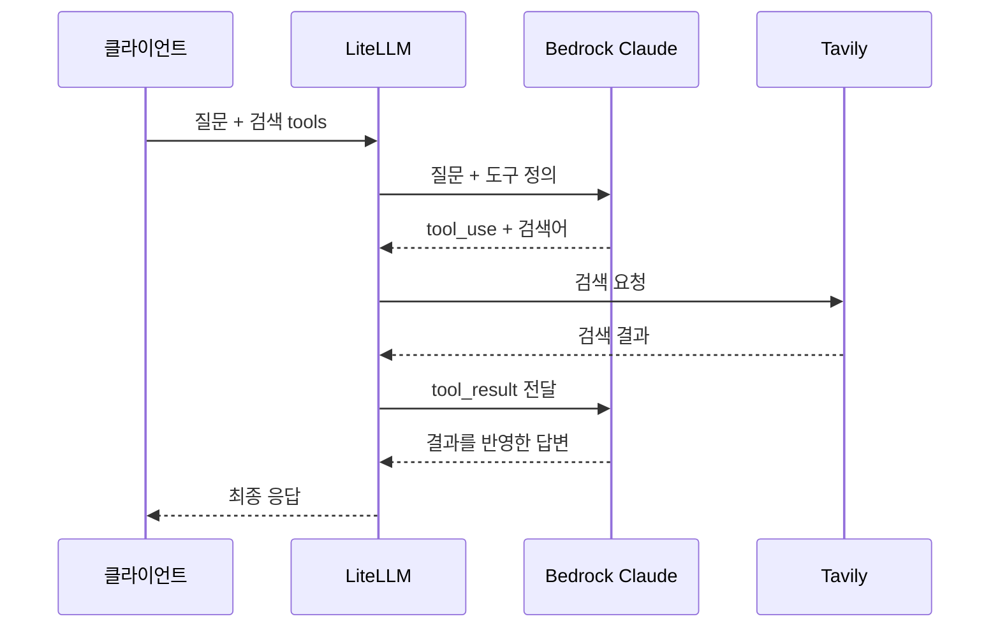

# LiteLLM Lab README
Bedrock · Guardrails · Tavily 웹 검색 · S3 로그

[Notion 문서](https://app.notion.com/p/400bd333566981db82d0eae1e0d9a738)

> 작성 기준: 2026-10-21. 현재 `compose.yaml`, `config.yaml`, 두 Python 콜백을 읽어 정리한 구성 기록입니다. 코드 블록은 설명에 필요한 발췌이며, 전체 설정 파일을 대체하지 않습니다. 비밀값은 포함하지 않았습니다.

## 1. 이 환경에서 하는 일

LiteLLM이 클라이언트 요청을 Bedrock의 Claude 모델로 전달합니다. 입력 가드레일로 요청을 검사하고, 차단 오류를 한국어로 바꿉니다. 웹 검색 도구가 호출되면 Tavily 검색 결과를 Claude에 다시 전달하며, 성공 호출의 선택된 로그 필드는 S3에 저장합니다.

| 파일 | 핵심 역할 |
| --- | --- |
| `compose.yaml` | LiteLLM·PostgreSQL 실행, 환경변수 전달, Python 파일 마운트 |
| `config.yaml` | 모델 별칭, 가드레일, 콜백, Tavily 검색 도구 등록 |
| `guardrail_error_handler.py` | 특정 가드레일의 HTTP 400 오류 메시지를 한국어로 변환 |
| `s3_access_logger_handler.py` | 성공 로그에서 필요한 필드를 골라 `S3Logger`에 전달 |


*그림 1. 입력과 모델 출력을 독립적으로 평가하는 AWS ApplyGuardrail 개념도. 출처: [AWS 공식 블로그](https://aws.amazon.com/blogs/machine-learning/implement-model-independent-safety-measures-with-amazon-bedrock-guardrails/).*

## 2. 실행과 파일 연결

현재 이미지는 `docker.litellm.ai/berriai/litellm:main-stable`, 데이터베이스는 PostgreSQL 16입니다. LiteLLM은 4000번 포트로 서비스하며 PostgreSQL healthcheck 통과 후 시작합니다.

```yaml
# compose.yaml → services.litellm 아래 발췌
volumes:
  - ./config.yaml:/app/config.yaml:ro
  - ./guardrail_error_handler.py:/app/guardrail_error_handler.py:ro
  - ./s3_access_logger_handler.py:/app/s3_access_logger_handler.py:ro

environment:
  AWS_GUARDRAIL_ID: ${AWS_GUARDRAIL_ID}
  AWS_REGION: ${AWS_REGION}
  AWS_ROLE_ARN: ${AWS_ROLE_ARN}
  TAVILY_API_KEY: ${TAVILY_API_KEY}
```

`파일명.handler`는 해당 Python 모듈의 최상위 `handler` 객체를 가리킵니다. 호스트에 파일이 있어도 컨테이너에 연결되지 않으면 `ModuleNotFoundError`가 발생합니다.

처음 실행할 때는 `docker compose up -d`로 전체 서비스를 시작합니다. PostgreSQL이 실행 중인 기존 환경에서 환경변수·볼륨 등 Compose 설정을 바꿨다면 `litellm-demo` 디렉터리에서 적용합니다.

```bash
docker compose up -d --no-deps --force-recreate litellm
docker compose logs --tail 100 litellm
```

단순 `docker compose restart`는 변경된 Compose 구성을 반영하지 않습니다. `environment` 값은 서비스의 `env_file`보다 우선하고, `${AWS_REGION}` 치환에는 실행 셸·Compose 환경 파일 값이 영향을 줍니다. [Docker 재시작](https://docs.docker.com/reference/cli/docker/compose/restart/) · [환경변수 우선순위](https://docs.docker.com/compose/how-tos/environment-variables/envvars-precedence/)

## 3. config.yaml 핵심

### 모델·콜백·검색 도구

클라이언트는 `model_name` 별칭으로 요청하고, LiteLLM은 `litellm_params.model`에 지정된 실제 모델로 전달합니다.

```yaml
# config.yaml 핵심 발췌
model_list:
  - model_name: claude-sonnet-4-6
    litellm_params:
      model: bedrock/global.anthropic.claude-sonnet-4-6

litellm_settings:
  callbacks:
    - guardrail_error_handler.handler
    - s3_access_logger_handler.handler
    - websearch_interception

  websearch_interception_params:
    enabled_providers: [bedrock]
    search_tool_name: tavily-search

search_tools:
  - search_tool_name: tavily-search
    litellm_params:
      search_provider: tavily
      api_key: os.environ/TAVILY_API_KEY
```

`search_tools`는 최상위, `websearch_interception_params`는 `litellm_settings` 바로 아래에 둡니다. `os.environ/변수명`은 LiteLLM 설정에서 환경변수를 참조하는 표현입니다. 검색 실행에는 요청의 검색 도구도 필요합니다. [LiteLLM 웹 검색 연동](https://docs.litellm.ai/docs/integrations/websearch_interception)

### 가드레일

| 이름 | 시점·방식 | 현재 설정에서 중요한 점 |
| --- | --- | --- |
| `aws-bedrock-guardrail` | `pre_call`, 정책 ID 기반 ApplyGuardrail | `default_on: true`, 입력 검사·마스킹 |
| `aws-bedrock-grounding` | `post_call`, 정책 ID 기반 ApplyGuardrail | 출력 마스킹·grounding, 스트리밍 버퍼 사용. `default_on` 미지정 |
| `aws-bedrock-checks` | `pre_call`, 정책 ID 없는 InvokeGuardrailChecks | 콘텐츠·프롬프트 공격·민감정보 검사. `default_on` 미지정 |

**파일상 기본 적용을 명시한 것은 입력 가드레일 하나입니다.** 나머지는 요청의 가드레일 선택이나 별도 정책 연결을 확인해야 합니다.

```yaml
# 입력 가드레일의 현재 설정
guardrails:
  - guardrail_name: aws-bedrock-guardrail
    litellm_params:
      guardrail: bedrock
      mode: pre_call
      guardrailIdentifier: os.environ/AWS_GUARDRAIL_ID
      guardrailVersion: "DRAFT"
      aws_region_name: os.environ/AWS_REGION
      default_on: true
      mask_request_content: true
```

정책 ID 기반 검사는 가드레일이 생성된 리전을 사용합니다. `contextual_grounding_from_messages: true`는 시스템 메시지를 근거 자료로, 마지막 사용자 메시지를 질문으로 활용합니다. `checks`는 정책 ID와 함께 설정하지 않으며, 현재 임계값은 콘텐츠 `0.1`, 공격 `0.5`, 개인정보 `0.7`입니다. [LiteLLM Bedrock Guardrails](https://docs.litellm.ai/docs/proxy/guardrails/bedrock)

세 가드레일이 같은 `AWS_REGION`을 참조하므로, checks를 사용할 때는 해당 API의 지원 리전을 확인해야 합니다. 작성일 기준 공식 목록에는 도쿄가 포함되고 서울은 없습니다. [AWS InvokeGuardrailChecks 사용 가이드](https://docs.aws.amazon.com/bedrock/latest/userguide/guardrails-use-invoke-guardrail-checks.html)

기타 현재 값: DB 모델 저장 활성화, 설정 재로드 간격 `30초`, DB 연결 풀 `10`, `X-Forwarded-For` 사용. `trusted_proxy_ranges: ["0.0.0.0/0"]`는 모든 IPv4 프록시를 신뢰하는 실습 설정이므로 실제 배포에서는 신뢰할 프록시 범위를 지정합니다.

## 4. 가드레일 오류를 한국어로 바꾸는 코드

`async_post_call_failure_hook`가 다음 조건을 모두 만족할 때만 오류를 변환합니다.

- HTTP 상태가 `400`이고 `detail`이 딕셔너리
- `detail["error"] == "Violated guardrail policy"`
- 가드레일 이름이 `MESSAGES`에 등록됨 — **현재는 `aws-bedrock-guardrail` 하나**

`contentPolicy`에는 여러 유형이 들어올 수 있으므로, 실제 차단된 `assessments[].matches[].type`을 집합으로 모아 구분합니다.

```python
types = {
    m.get("type")
    for a in detail.get("assessments", [])
    if isinstance(a, dict)
    for m in a.get("matches", [])
    if isinstance(m, dict) and m.get("action") == "BLOCKED"
}

# 기존 if/elif 체인의 핵심 분기 발췌
elif "promptAttack" in checks or "PROMPT_ATTACK" in types:
    message = "프롬프트 조작으로 판단되는 요청이 차단되었습니다."

elif "HATE" in types:
    message = "혐오발언이 감지되어 요청이 차단되었습니다."
```

현재 우선순위는 **개인정보 → 프롬프트 공격 → grounding → HATE → MISCONDUCT → PROFANITY → 일반 콘텐츠 → 주제 정책**입니다. 여러 유형이 함께 있어도 첫 번째로 일치한 메시지 하나가 선택됩니다.

마지막에 `HTTPException(status_code=400, detail=message)`를 반환하면 클라이언트 오류가 바뀌고, `None`을 반환하면 원래 오류를 유지합니다. 따라서 연결 실패 등 HTTP 500은 이 조건에서 변환하지 않습니다. [LiteLLM 오류 응답 변환](https://docs.litellm.ai/docs/proxy/call_hooks#advanced---transform-error-responses)

> 현재 코드 메모: `MISCONDUCT`, `PROFANITY`, `topicPolicy`에 주민등록번호 관련 문구가 연결돼 있습니다. 이는 이 실습의 사용자 정의 메시지이며, 해당 유형이 주민등록번호 검출을 뜻한다는 근거가 되지는 않습니다. 또 `checks`·`policies`는 `types`와 달리 `BLOCKED` 필터가 없습니다.

## 5. S3에 필요한 로그 필드만 전달하기

`s3_access_logger_handler.py`는 내장 `S3Logger`를 상속하고 **성공 이벤트**를 재정의합니다. `standard_logging_object`에서 필요한 필드를 골라 상위 로거에 전달하는 부분이 핵심입니다.

```python
payload = kwargs.get("standard_logging_object")
if not payload:
    return

metadata = payload.get("metadata") or {}
selected = {key: payload.get(key) for key in FIELDS}
selected["metadata"] = {
    key: metadata.get(key) for key in IDENTITY_FIELDS
}

# 실제 파일은 IP 관련 두 필드도 추가한 뒤 전달한다.
await super().async_log_success_event(
    kwargs={**kwargs, "standard_logging_object": selected},
    response_obj=response_obj,
    start_time=start_time,
    end_time=end_time,
)
```

| 구분 | 선택 필드 |
| --- | --- |
| 호출 | `id`, `startTime`, `endTime`, `model`, `status` |
| 사용량·비용 | `prompt_tokens`, `completion_tokens`, `total_tokens`, `response_cost` |
| 사용자·팀 | `metadata.user_api_key_user_id`, `metadata.user_api_key_team_id`, `metadata.user_api_key_alias` |
| 주소 | `requester_ip_address`, `request.client.host` |

내장 `s3_v2`는 `kwargs["standard_logging_object"]`를 저장 대상으로 읽습니다. 이 객체를 필터한 값으로 교체하는 것이 중요합니다. [LiteLLM 공식 s3_v2 소스](https://github.com/BerriAI/litellm/blob/main/litellm/integrations/s3_v2.py)

현재 저장 prefix는 `litellm/request-logs`, 리전은 `os.getenv("AWS_REGION", "us-east-1")`입니다. Python 코드에서는 이처럼 `os.getenv`로 값을 읽습니다.

**필터 범위는 재정의한 성공 로그 경로입니다.** 실패 로그나 다른 출력까지 동일하게 필터된다고 보장하지 않습니다. IP 값은 기존 payload/metadata에서 읽으므로 값이 없으면 `None`이 됩니다. 현재 코드는 선택한 로그를 stdout에도 출력합니다.

## 6. 인터넷 검색이 동작하는 순서



*그림 2. 현재 검색 설정을 설명하기 위해 작성한 순서도. 검색 도구가 실제 호출된 경우의 흐름이며, 가드레일·로그 처리는 생략했습니다.*

`websearch_interception`은 모델이 요청한 검색을 Tavily로 실행하고 결과를 모델에 다시 전달합니다. 콜백을 등록해도 요청에 검색 도구가 없으면 이 흐름은 시작되지 않습니다. [LiteLLM 웹 검색 공식 문서](https://docs.litellm.ai/docs/integrations/websearch_interception)

`/v1/messages`용 요청 예시입니다. `LITELLM_KEY`는 해당 모델·검색 도구를 사용할 수 있는 프록시 키를 사용합니다.

```bash
curl http://localhost:4000/v1/messages \
  -H "Authorization: Bearer $LITELLM_KEY" \
  -H "anthropic-version: 2023-06-01" \
  -H "content-type: application/json" \
  -d '{
    "model": "claude-sonnet-4-6",
    "max_tokens": 1000,
    "messages": [
      {"role": "user", "content": "서울의 오늘 날씨를 검색하고 출처 URL을 알려줘."}
    ],
    "tools": [
      {"type": "web_search_20250305", "name": "web_search"}
    ]
  }'
```

이 예시는 Anthropic Messages 형식입니다. `/v1/chat/completions`에서는 `litellm_web_search` 함수 도구 형식을 사용합니다. 실제 검색 여부는 도구 실행이나 Tavily 호출 로그로 확인합니다.

## 7. 자주 겪은 오류와 확인 지점

| 증상 | 확인할 부분 |
| --- | --- |
| `ModuleNotFoundError: s3_access_logger_handler` | 콜백 파일명·최상위 `handler`·Compose 마운트를 확인하고 컨테이너 재생성 |
| `bedrock-runtime.admin.amazonaws.com` 연결 실패 | 리전 자리에 `admin`이 들어간 주소. 컨테이너 환경변수와 UI/개별 요청의 리전 설정 확인 |
| 모델이 “인터넷 기능이 없다”고 답함 | 요청의 검색 `tools` 포함 여부와 실제 도구 호출 확인 |
| grounding/checks 메시지가 한국어로 바뀌지 않음 | 현재 `MESSAGES`에 입력 가드레일만 등록돼 있음 |

아래는 기존 README에 있던 **과거 실습 결과 화면**입니다. HTTP 400 가드레일 차단 사례를 보여주며, 현재 한국어 변환 코드의 재검증 결과는 아닙니다.


*그림 3. 저장소의 기존 README 첨부 이미지. 출처: 프로젝트 실습 기록.*

이 문서는 현재 파일과 공식 자료의 대응 관계를 정리한 것입니다. `main-stable` 이미지 태그와 공식 소스의 `main`은 변경될 수 있으므로 재현이 필요할 때는 사용한 이미지 버전 또는 digest를 함께 기록합니다.

